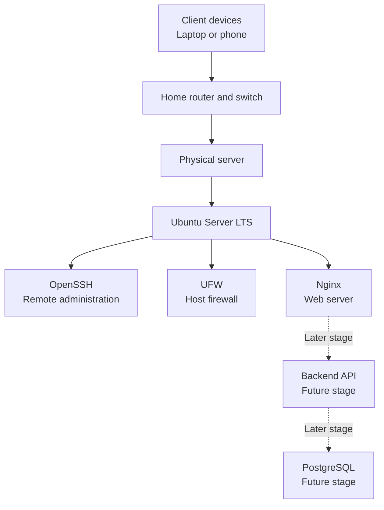

# Home Lab Server Engineering

A hands-on project for building, configuring, securing, operating, and documenting a physical home lab server.

This repository is a practical engineering record covering server hardware, Linux administration, network configuration, remote access, web hosting, application deployment, database administration, monitoring, backups, troubleshooting, and disaster recovery.

The goal is not simply to install a server. The goal is to understand how its components work together and to document a repeatable process for deploying and maintaining a reliable system.

---

## Project Status

**Status:** In progress  
**Project type:** Home lab infrastructure and systems administration  
**Primary operating system:** Ubuntu Server LTS  
**Deployment target:** Physical computer on a private home network  
**Documentation format:** Markdown  
**Repository management:** GitHub website

This repository describes a staged build. A stage is not considered complete until its configuration has been tested and its results documented.

Hardware specifications, IP addresses, test results, and screenshots must reflect the actual environment once the project is implemented. Examples in this README are illustrative.

## 1. Project Objectives

The project is designed to develop practical skills in:

- Selecting server hardware based on workload, cost, power consumption, and upgradeability.
- Understanding CPUs, memory, storage, cooling, power supplies, and network interfaces.
- Installing and administering a Linux server operating system.
- Managing users, permissions, packages, services, processes, and system logs.
- Understanding local networks, Ethernet, IP addresses, DHCP, DNS, ports, and routing.
- Configuring secure remote administration through SSH.
- Configuring host-based firewall rules.
- Hosting a website with Nginx.
- Deploying a backend API and connecting it to a database.
- Understanding containers and virtual machines.
- Monitoring system health and application availability.
- Performing backups and testing restoration.
- Diagnosing faults methodically and documenting corrective actions.
- Producing technical documentation suitable for a public engineering portfolio.

## 2. Project Scope

The project begins with one physical server connected to a trusted private network.

The initial scope includes:

1. Hardware planning and inventory.
2. Network planning.
3. Operating-system installation.
4. Initial configuration and system updates.
5. SSH remote access.
6. Firewall configuration.
7. Nginx web server deployment.
8. Service validation and troubleshooting.
9. Backup and maintenance procedures.

Later stages can extend the environment with a database, a backend API, containerized applications, monitoring tools, and virtualization.

Public internet exposure is not required for the initial project.

## 3. Planned Architecture



The diagram represents the intended architecture, not proof that every component has already been installed.

## 4. Hardware Planning

The following specifications are a starting target, not a requirement to purchase a new computer.

| Component | Initial target | Reason |
|---|---|---|
| Computer | Existing desktop, refurbished business PC, or mini PC | Keeps initial cost manageable |
| CPU | Modern 64-bit Intel or AMD processor, preferably 4 or more cores | Supports the OS and several services |
| RAM | 16 GB | Suitable for a small server with several learning services |
| Storage | 500 GB SSD | Provides room for the OS, applications, logs, and project data |
| Network | Gigabit Ethernet preferred | Reliable wired connectivity |
| Cooling | Working CPU cooler and case ventilation | Prevents overheating |
| Power | Compatible, reliable power supply | Stable operation |
| Backup power | UPS where practical | Reduces disruption during power interruptions |

The final hardware inventory must be updated after inspecting the actual equipment.

Before purchasing components, check CPU and motherboard compatibility, supported memory type, storage interfaces, physical dimensions, cooling requirements, and power consumption.

A discrete graphics card is not required for this initial project.

## 5. Software Plan

| Software | Planned purpose |
|---|---|
| Ubuntu Server LTS | Operating system |
| OpenSSH | Secure remote administration |
| UFW | Host-based firewall |
| Nginx | HTTP web server and potential reverse proxy |
| PostgreSQL | Relational database |
| Go | Backend API development |
| Docker | Optional application containerization |
| Monitoring tools | System and service health checks |

Software will be added incrementally. Every installation must have a documented purpose and a verification procedure.

The intended Ubuntu release will be confirmed against the official Ubuntu Server download page immediately before installation. Prefer an appropriate supported LTS release for this long-lived learning server.

- Ubuntu Server: https://ubuntu.com/download/server
- Ubuntu Server documentation: https://ubuntu.com/server/docs/

## 6. Network Design

The initial server will operate on a private local network.

The network plan will document:

- Router or gateway.
- Server hostname.
- Server network interface.
- Assigned IP address.
- DHCP reservation, if configured.
- Client device used for testing.
- Services that are allowed to receive connections.
- How local access is tested.

An example local address is `192.168.1.50`. This is only a placeholder; the actual address must be discovered from the home network.

A DHCP reservation on the router is preferred for keeping the server's address consistent without manually assigning an address that might conflict with another device.

## 7. Security Principles

Security is part of the build, not an optional final step.

- Keep the operating system and installed packages updated.
- Use a normal administrative account with `sudo` for routine administration.
- Allow only the network connections that are required.
- Permit SSH before enabling a firewall when remote access is needed.
- Verify firewall rules before testing remote connections.
- Use SSH key authentication when ready to configure it safely.
- Avoid direct public exposure of SSH, database ports, and administrative interfaces.
- Do not store passwords, private keys, API tokens, or Wi-Fi credentials in this repository.
- Do not publish screenshots containing credentials, personal information, or private network details.
- Keep separate backups and test that data can actually be restored.
- Review configuration changes before restarting critical services.

A home lab is for controlled experimentation. It should not be treated as a production system protecting other people's data.

## 8. Implementation Roadmap

### Phase 1 — Plan the server

- [ ] Define the intended workloads.
- [ ] Inspect available hardware.
- [ ] Complete the hardware inventory.
- [ ] Decide whether existing hardware is sufficient.
- [ ] Document the proposed network.
- [ ] Record the main risks and prerequisites.

### Phase 2 — Install Ubuntu Server

- [ ] Download a supported Ubuntu Server LTS image.
- [ ] Create a bootable USB installer.
- [ ] Back up data on the target computer.
- [ ] Install the operating system.
- [ ] Create the administrative user.
- [ ] Confirm that the machine boots correctly.
- [ ] Record the operating-system version and hardware details.

### Phase 3 — Configure the base system

- [ ] Update package information and installed packages.
- [ ] Set a useful hostname.
- [ ] Check network connectivity.
- [ ] Enable and verify OpenSSH.
- [ ] Record the server's local IP address.
- [ ] Configure the firewall carefully.
- [ ] Confirm that remote administration still works.

### Phase 4 — Deploy the first web service

- [ ] Install Nginx.
- [ ] Enable the service at startup.
- [ ] Verify service status.
- [ ] Test the default website locally.
- [ ] Test access from another trusted device.
- [ ] Record the test result.
- [ ] Document any errors and their resolution.

### Phase 5 — Add application services

- [ ] Install and configure PostgreSQL.
- [ ] Create a small backend API.
- [ ] Connect the API to the database.
- [ ] Document configuration and service dependencies.
- [ ] Validate application behavior.
- [ ] Consider Docker after understanding the initial deployment.

### Phase 6 — Operate and maintain the server

- [ ] Define a backup procedure.
- [ ] Complete a test restoration.
- [ ] Establish routine update checks.
- [ ] Check disk usage and service health.
- [ ] Document common failure scenarios.
- [ ] Test recovery after a planned restart.
- [ ] Record maintenance activities.

## 9. Validation Strategy

A successful installation does not automatically mean a successful deployment.

Each stage should have specific tests and recorded outcomes.

| Test | Expected result |
|---|---|
| Operating-system check | Server boots and reports the expected OS version |
| Network check | Server has a valid address and can reach the required network |
| SSH check | Authorized client can establish a remote session |
| Firewall check | Required connections work and unnecessary inbound connections are restricted |
| Web service check | Nginx is active and serves the expected page |
| Client check | Another permitted device can reach the website |
| Restart check | Essential services return after a planned reboot |
| Backup check | Selected files can be restored and verified |

Record actual results. Do not mark a test as passed merely because the commands were executed.

## 10. Documentation Structure

The repository will grow into the following structure:

```text
home-lab-server-engineering/
├── README.md
├── docs/
│   ├── project-overview.md
│   ├── hardware-selection.md
│   ├── network-design.md
│   ├── installation/
│   │   ├── ubuntu-server-installation.md
│   │   └── first-boot.md
│   ├── security/
│   │   ├── ssh.md
│   │   └── firewall.md
│   ├── services/
│   │   ├── nginx-web-server.md
│   │   ├── postgresql.md
│   │   ├── go-backend-api.md
│   │   └── docker.md
│   ├── operations/
│   │   ├── monitoring.md
│   │   ├── backup-and-restore.md
│   │   └── maintenance.md
│   ├── troubleshooting.md
│   ├── disaster-recovery.md
│   ├── glossary.md
│   └── references.md
├── inventory/
│   ├── hardware-inventory.md
│   └── network-inventory.md
├── checklists/
│   ├── pre-installation.md
│   └── validation-checklist.md
├── logs/
│   ├── build-log.md
│   └── maintenance-log.md
└── evidence/
    └── screenshots/
        └── README.md
```

This is the planned structure. Files will be added as their respective stages are completed.

## 11. Build and Maintenance Records

For each implementation stage, record:

- Date.
- Objective.
- Hardware or software involved.
- Actions performed.
- Commands used.
- Expected behavior.
- Observed behavior.
- Errors encountered.
- Troubleshooting process.
- Final test result.
- Lessons learned.

A useful engineering record explains not only what worked, but why it worked, what failed, and how the result was verified.

## 12. Troubleshooting Method

When a service fails, follow a consistent diagnostic sequence:

1. Define the observed problem.
2. Identify the affected system or service.
3. Check power, cabling, network connectivity, and available resources.
4. Check service status and relevant logs.
5. Inspect recent configuration changes.
6. Form a testable explanation.
7. Change one relevant variable at a time.
8. Retest the service.
9. Record the root cause and corrective action.
10. Document a preventive measure where appropriate.

Avoid applying random commands without understanding their effect, especially when they change firewall rules, disk partitions, permissions, or network configuration.

## 13. Risks and Recovery

The main risks include accidental data loss, incorrect firewall rules, SSH lockout, hardware failure, interrupted updates, insufficient storage, and configuration errors.

Before destructive disk operations, back up the required data and verify the intended target disk.

Before changing remote-access or network configuration, make sure there is a recovery method such as local console access.

Before major upgrades, check the current backup and confirm that critical services and configuration files can be recovered.

## 14. Learning Outcomes

By completing the planned stages, the project should demonstrate practical understanding of:

- Physical server planning.
- Linux system administration.
- TCP/IP networking.
- Secure remote administration.
- Host-based firewalls.
- Web server deployment.
- Backend application deployment.
- Database fundamentals.
- Service lifecycle management.
- Monitoring and troubleshooting.
- Backup and recovery planning.
- Technical writing and operational documentation.

The portfolio should be supported by actual configuration records, test results, and safe-to-share evidence rather than unsupported claims.

## 15. Official References

- Ubuntu Server downloads: https://ubuntu.com/download/server
- Ubuntu Server tutorial: https://ubuntu.com/server/docs/tutorial/
- Ubuntu Server installation: https://ubuntu.com/server/docs/tutorial/basic-installation/
- Ubuntu firewall documentation: https://ubuntu.com/server/docs/firewalls/
- Ubuntu OpenSSH documentation: https://ubuntu.com/server/docs/openssh-server/
- Nginx Beginner's Guide: https://nginx.org/en/docs/beginners_guide.html
- GitHub repository documentation: https://docs.github.com/en/repositories

Consult official documentation when syntax, package availability, or software behavior changes between releases.

---

**Project principle:** Build deliberately, configure securely, test every stage, document the evidence, and understand the system rather than merely copying commands.
