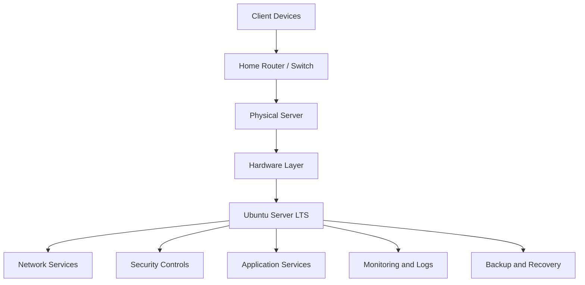
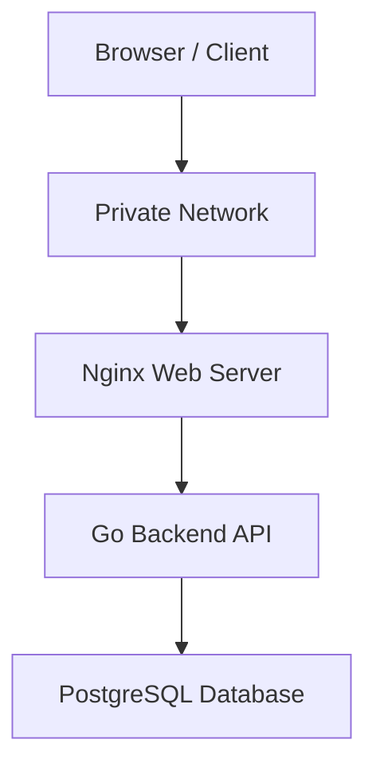

# Project Overview — Home Lab Server Engineering

## 1. Introduction

### 1.1 Project Description

Home Lab Server Engineering is a practical infrastructure project focused on designing, assembling, installing, configuring, securing, and maintaining a physical server in a private home network.

The project aims to reproduce fundamental tasks involved in operating a small server environment.

Rather than treating a server as a computer that simply runs applications, this project approaches it as an integrated system consisting of:

- Physical computing hardware.
- Operating system.
- Network infrastructure.
- Storage and filesystems.
- User and permission management.
- Security controls.
- Application services.
- Databases.
- Monitoring systems.
- Backup and recovery procedures.
- Operational documentation.

The initial deployment will use one physical server running Ubuntu Server LTS.

The system will initially operate within a private local network. Additional services and infrastructure components will be introduced as the project develops.

### 1.2 Project Philosophy

The project follows five engineering principles:

1. Understand the architecture before implementing it.
2. Make deliberate hardware and software decisions.
3. Configure security from the beginning.
4. Test every implementation stage.
5. Document actual results and operational procedures.

Commands should not simply be copied and executed without understanding their purpose.

Every major configuration should have an explanation, an expected result, a verification method, and a troubleshooting procedure.

---

## 2. Background and Motivation

Servers are fundamental components of modern computing infrastructure.

They support websites, APIs, databases, cloud applications, file storage, enterprise systems, industrial applications, and network services.

Understanding server infrastructure requires knowledge of multiple technical disciplines.

For example:

- Hardware engineering determines the physical capabilities and limitations of a server.
- Operating system administration manages resources and running services.
- Networking enables communication between clients and servers.
- Security protects the system and its data.
- Software engineering provides the applications and services running on the infrastructure.
- Systems administration ensures the environment remains operational.

A home lab provides an environment in which these disciplines can be studied and practised without requiring access to an enterprise data center.

This project will use practical implementation rather than theoretical study alone.

---

## 3. Project Goals

### 3.1 Primary Goal

Build and operate a functional physical server that provides network-accessible services and demonstrates practical knowledge of server infrastructure and administration.

### 3.2 Technical Goals

The project will aim to achieve the following:

**Hardware engineering**
- Understand server hardware requirements.
- Evaluate CPU, memory, storage, networking, cooling, and power.
- Select compatible hardware.
- Maintain a hardware inventory.
- Understand upgrade and expansion possibilities.

**Operating system administration**
- Install Ubuntu Server LTS.
- Configure users and permissions.
- Manage software packages.
- Manage system services.
- Inspect processes and system resources.
- Read and interpret system logs.

**Networking**
- Understand Ethernet and network interfaces.
- Configure and inspect IP connectivity.
- Understand DHCP and DNS.
- Understand routing and default gateways.
- Configure remote administration.
- Identify and troubleshoot connectivity failures.

**Security**
- Configure SSH securely.
- Apply firewall policies.
- Restrict unnecessary services.
- Manage administrative privileges.
- Apply security updates.
- Protect credentials and sensitive information.

**Application hosting**
- Deploy Nginx.
- Host a test website.
- Deploy a backend application.
- Connect an application to a database.
- Understand application service management.

**Operations**
- Monitor server health.
- Maintain sufficient disk space.
- Configure backups.
- Test restoration.
- Diagnose common failures.
- Document maintenance activities.

### 3.3 Secondary Goals

As the initial environment becomes stable, the project may expand into:

- Docker containerization.
- Virtual machines.
- Proxmox VE.
- Additional Linux servers.
- Network segmentation.
- Centralized monitoring.
- Automated backup processes.
- Reverse proxy configuration.
- Internal DNS.
- Cloud deployment.
- Infrastructure automation.

These are extensions, not prerequisites for completing the first server.

---

## 4. Project Scope

### 4.1 Included in the Initial Scope

The initial implementation includes:

| Area | Included functionality |
|---|---|
| Hardware | One physical server |
| Operating system | Ubuntu Server LTS |
| Networking | Private local network |
| Administration | Local console and SSH |
| Security | User management and UFW |
| Web services | Nginx |
| Testing | Connectivity and service validation |
| Documentation | Configuration and test records |
| Operations | Basic updates, monitoring and backup planning |

### 4.2 Future Extensions

The following capabilities may be implemented after the initial server is operational:

| Extension | Intended purpose |
|---|---|
| PostgreSQL | Relational database management |
| Go backend API | Backend development and deployment |
| Docker | Application containerization |
| Proxmox VE | Virtual machine management |
| Monitoring stack | Infrastructure health monitoring |
| VPN | Secure remote network access |
| File storage | Network-accessible file services |
| Cloud integration | Hybrid infrastructure experiments |

### 4.3 Excluded from Initial Scope

The initial implementation will not attempt to:

- Operate a commercial hosting business.
- Replace enterprise-grade infrastructure.
- Provide guaranteed production availability.
- Expose administrative services directly to the public internet.
- Store sensitive third-party information.
- Implement complex high-availability clustering.
- Build a multi-rack data center.

The objective is to develop transferable engineering skills through a manageable environment.

---

## 5. Intended Workloads

The server will support several learning and testing workloads.

### 5.1 Web Hosting

The first application workload will be a simple website served by Nginx.

Expected capabilities:

- Accept HTTP requests from permitted clients.
- Serve static web content.
- Return appropriate HTTP responses.
- Provide access and error logs.
- Start automatically when the server boots.

### 5.2 Backend Application Hosting

A later stage will introduce a backend API written in Go.

The API will demonstrate:

- HTTP request handling.
- Routing.
- JSON responses.
- Application configuration.
- Database connectivity.
- Error handling.
- Service management.

The API will initially be accessible only from the trusted local network.

### 5.3 Database Workload

PostgreSQL will provide relational data storage.

The database stage will cover:

- Database installation.
- Database and user creation.
- Authentication.
- SQL queries.
- Application connectivity.
- Backup and restoration.
- Database access restrictions.

The database should not be exposed unnecessarily to the network.

### 5.4 Infrastructure Administration

The server will also be used to practise:

- Package management.
- User administration.
- Filesystem management.
- Process management.
- Service lifecycle management.
- Firewall configuration.
- System updates.
- Resource monitoring.
- Troubleshooting.

---

## 6. System Architecture

### 6.1 Physical Architecture

The initial system consists of:

1. A physical server computer.
2. A compatible power supply.
3. Local storage.
4. A wired network connection.
5. A home router or network switch.
6. A client computer used for administration and testing.
7. A UPS where available.

The physical server will operate independently of the client computer once installation and configuration are complete.

### 6.2 Logical Architecture

The system will be organized into the following layers:

| Layer | Responsibility |
|---|---|
| Hardware | Processing, memory, storage, power and networking |
| Firmware | BIOS/UEFI initialization and hardware configuration |
| Operating system | Resource management and system administration |
| Network | Communication and connectivity |
| Security | Access control and traffic restrictions |
| Services | Web server, API, database and other applications |
| Monitoring | System health and service availability |
| Backup | Data protection and recovery |

### 6.3 Logical Architecture Diagram

This is a conceptual architecture. Actual interfaces, services and network paths will be documented during implementation.

### 6.4 Application Architecture

The intended application architecture is:

The initial deployment will only include the Nginx stage. The backend and database components will be added later.

---

## 7. Hardware Requirements

### 7.1 Minimum Practical Starting Configuration

The following is a suggested starting specification for a small learning server.

| Component | Suggested specification |
|---|---|
| Processor | 64-bit Intel or AMD CPU |
| CPU cores | 4 or more preferred |
| Memory | 16 GB RAM |
| Storage | 500 GB SSD |
| Network | Gigabit Ethernet |
| Graphics | Integrated graphics sufficient |
| Cooling | Functional CPU and case cooling |
| Power supply | Compatible and reliable |
| Backup power | UPS recommended |

These are planning targets rather than mandatory requirements.

A lower-powered computer may still be sufficient for Ubuntu Server and Nginx.

### 7.2 Hardware Compatibility

Before purchasing or assembling hardware, verify:

- CPU and motherboard socket compatibility.
- Motherboard-supported processor generation.
- RAM generation and capacity limits.
- Storage interface compatibility.
- Available PCIe slots.
- Case dimensions.
- Power supply capacity and connectors.
- Cooling requirements.
- Network adapter compatibility.

### 7.3 Hardware Selection Criteria

Hardware will be evaluated according to:

1. Purchase cost.
2. Processing capability.
3. Memory capacity.
4. Storage expandability.
5. Network capability.
6. Power consumption.
7. Cooling and noise.
8. Reliability.
9. Availability of replacement components.
10. Future upgrade potential.

### 7.4 Power Considerations

The server is intended to run for extended periods.

Power consumption should therefore be considered when selecting components.

A UPS is recommended where practical to provide temporary power during interruptions and allow an orderly shutdown.

The server's actual power consumption should be measured or estimated after the hardware is selected.

---

## 8. Software Architecture

### 8.1 Base Operating System

Ubuntu Server LTS will be used as the initial operating system.

Reasons for this choice:

- Linux administration experience.
- Strong server and networking ecosystem.
- Package management through APT.
- OpenSSH support.
- Availability of common server applications.
- Extensive official documentation.
- Compatibility with backend development tools.

The exact supported LTS release will be confirmed before installation.

Official resources:

- https://ubuntu.com/download/server
- https://ubuntu.com/server/docs/

### 8.2 Initial Software Components

| Component | Responsibility |
|---|---|
| Ubuntu Server | Operating system |
| OpenSSH | Remote administration |
| UFW | Firewall management |
| Nginx | Web hosting |
| APT | Package management |
| systemd | Service management |
| curl | HTTP and network testing |
| htop | Process and resource inspection |

### 8.3 Future Software Components

| Component | Responsibility |
|---|---|
| PostgreSQL | Relational data storage |
| Go | Backend application development |
| Docker | Containerized deployment |
| Prometheus | Metrics collection |
| Grafana | Monitoring dashboards |
| Proxmox VE | Virtualization platform |

Future software will be installed only when its purpose and requirements have been documented.

---

## 9. Network Design

### 9.1 Network Environment

The server will initially operate on a private home network.

A wired Ethernet connection is preferred for stability.

The home router will provide network connectivity and normally handle DHCP address assignment.

### 9.2 Addressing

The server will initially obtain its address through DHCP.

After confirming the assigned address, a DHCP reservation may be configured on the router.

The following details will be recorded:

- Server hostname.
- Network interface name.
- MAC address.
- Assigned IPv4 address.
- Subnet mask or prefix.
- Default gateway.
- DNS resolver.
- DHCP reservation status.

Actual values will be documented in the network inventory.

### 9.3 Network Access

Initial permitted access should be limited to required services.

| Service | Default port | Purpose |
|---|---:|---|
| SSH | TCP 22 | Remote administration |
| HTTP | TCP 80 | Website access |
| HTTPS | TCP 443 | Encrypted web access when configured |
| PostgreSQL | TCP 5432 | Database access, restricted |

The actual firewall configuration will be documented separately.

Ports should not be opened merely because an application supports them.

### 9.4 Network Security

The initial server should not require public internet accessibility.

Remote administration should initially occur from trusted local devices.

If remote access from outside the home becomes necessary, a properly configured VPN should be evaluated.

---

## 10. Security Architecture

Security controls will be applied at multiple levels.

### 10.1 Account Security

- Use a dedicated administrative user.
- Avoid routine root login.
- Apply strong authentication.
- Use SSH keys when configured.
- Grant privileges only when necessary.
- Review user accounts periodically.

### 10.2 Network Security

- Apply a default-deny inbound firewall policy.
- Permit required services explicitly.
- Restrict database access.
- Avoid unnecessary port forwarding.
- Review listening network services.
- Use encrypted remote access.

### 10.3 System Security

- Install security updates.
- Remove unnecessary software.
- Monitor system logs.
- Review service permissions.
- Maintain backups.
- Protect sensitive configuration files.

### 10.4 Repository Security

This is a public portfolio repository.

It must never contain:

- Passwords.
- Private SSH keys.
- API secrets.
- Authentication tokens.
- Wi-Fi passwords.
- Database credentials.
- Sensitive personal information.

Use placeholders in examples.

For example:

`YOUR_SERVER_IP`

`YOUR_USERNAME`

`YOUR_DATABASE_PASSWORD`

Never replace placeholders with real secrets in public documentation.

---

## 11. Functional Requirements

Functional requirements describe what the system must do.

| ID | Requirement | Expected behavior |
|---|---|---|
| FR-01 | Operating system | Server boots into Ubuntu Server |
| FR-02 | Networking | Server obtains valid network configuration |
| FR-03 | Remote access | Authorized administrator can connect through SSH |
| FR-04 | Firewall | Unnecessary inbound connections are blocked |
| FR-05 | Web hosting | Nginx serves a web page |
| FR-06 | Local access | Permitted client devices can access the website |
| FR-07 | Service management | Essential services can be started and stopped |
| FR-08 | Monitoring | Administrator can inspect system health |
| FR-09 | Backup | Selected data can be backed up |
| FR-10 | Recovery | Backed-up data can be restored and verified |

Requirements FR-01 through FR-06 form the initial implementation target. The remaining requirements will be completed as later stages are developed.

---

## 12. Non-Functional Requirements

Non-functional requirements describe how the system should operate.

### 12.1 Reliability

- Essential services should start correctly after a planned restart.
- Configuration changes should be tested.
- Important data should be backed up.
- Recovery procedures should be documented.

### 12.2 Security

- Access should be restricted to authorized users.
- Unnecessary services should not listen on network interfaces.
- Software should receive appropriate security updates.
- Sensitive information should remain outside the public repository.

### 12.3 Maintainability

- Configuration should be documented.
- Service dependencies should be understood.
- Logs should be available for troubleshooting.
- Maintenance activities should be recorded.

### 12.4 Performance

- CPU and memory utilization should be observable.
- Disk space should be monitored.
- Applications should respond within reasonable expectations for the hardware.
- Resource requirements should be evaluated before adding services.

### 12.5 Cost

- Reuse suitable existing hardware where possible.
- Prefer free and open-source software.
- Avoid unnecessary subscriptions.
- Consider electricity consumption and replacement costs.

---

## 13. Technical Decisions

The following decisions establish the initial engineering direction.

| Decision | Selection | Reason |
|---|---|---|
| Deployment | Physical home server | Provides direct hardware experience |
| OS | Ubuntu Server LTS | Linux administration and server ecosystem |
| Network | Private local network | Reduces initial exposure |
| Connection | Ethernet | Reliable wired communication |
| Remote administration | OpenSSH | Standard secure remote management |
| Firewall | UFW | Accessible Linux firewall management |
| Web server | Nginx | Lightweight web hosting |
| Backend | Go | Practical backend development |
| Database | PostgreSQL | Relational database experience |
| Repository | GitHub | Public documentation and portfolio |
| Repository editing | GitHub website | No local Git workflow required |

These choices may be revisited if actual hardware or operational requirements make another approach more appropriate.

### 13.1 Ubuntu Server Versus Proxmox

Ubuntu Server will be installed directly on the physical machine initially.

This avoids introducing virtualization complexity before basic Linux administration is understood.

Proxmox VE may be considered in a future expansion when multiple isolated virtual machines are required.

### 13.2 Physical Server Versus Cloud Server

A physical home server provides direct experience with:

- Hardware assembly.
- BIOS and UEFI.
- Storage devices.
- Power management.
- Cooling.
- Ethernet connections.
- Local network administration.

Cloud servers provide additional experience with virtualized infrastructure, remote deployment, and cloud networking.

The two environments complement each other.

---

## 14. Project Implementation Phases

### Phase 1: Requirements and Planning

Deliverables:

- Hardware requirements.
- Hardware inventory.
- Network design.
- Software selection.
- Risk assessment.

Completion criteria:

The equipment and network requirements are understood and documented.

### Phase 2: Hardware Preparation

Deliverables:

- Physical server.
- Compatible components.
- Functional cooling.
- Network connection.
- Power configuration.

Completion criteria:

The computer powers on successfully and its hardware is recognized.

### Phase 3: Operating System Installation

Deliverables:

- Ubuntu Server installation.
- Administrative account.
- Hostname.
- Network connectivity.
- Initial system updates.

Completion criteria:

The server boots successfully and the administrator can access the operating system.

### Phase 4: Base Server Configuration

Deliverables:

- OpenSSH.
- Firewall.
- Network configuration.
- Basic administration tools.

Completion criteria:

Remote access works and firewall rules behave as intended.

### Phase 5: Web Server Deployment

Deliverables:

- Nginx installation.
- Web server configuration.
- Local website.
- Service validation.

Completion criteria:

A permitted client can access the hosted website.

### Phase 6: Application and Database Deployment

Deliverables:

- PostgreSQL.
- Go backend API.
- Application configuration.
- Database integration.

Completion criteria:

The API can communicate with the database and return expected responses.

### Phase 7: Monitoring and Maintenance

Deliverables:

- Resource monitoring.
- Service monitoring.
- Backup procedure.
- Restoration procedure.
- Maintenance records.

Completion criteria:

The administrator can inspect server health, maintain the system, and recover selected data.

### Phase 8: Documentation and Portfolio Review

Deliverables:

- Complete project documentation.
- Hardware inventory.
- Network inventory.
- Configuration records.
- Screenshots.
- Validation results.
- Lessons learned.

Completion criteria:

A technically competent reader can understand the architecture, reproduce the relevant configuration, and evaluate the documented results.

---

## 15. Testing and Acceptance Criteria

Each implementation phase will have a defined validation process.

### 15.1 Hardware Validation

Confirm:

- The system powers on.
- CPU is recognized.
- Installed RAM is detected.
- Storage is recognized.
- Network interface is available.
- Cooling is functional.

### 15.2 Operating System Validation

Confirm:

- Ubuntu Server boots correctly.
- System information is available.
- Package updates work.
- Administrative access works.
- Network connectivity works.

### 15.3 SSH Validation

Confirm:

- SSH service is active.
- Server is reachable from an authorized client.
- Authentication succeeds.
- Unauthorized access is not permitted.

### 15.4 Firewall Validation

Confirm:

- Firewall is active.
- Required ports are allowed.
- Unnecessary inbound connections are restricted.
- Remote administration remains available.

### 15.5 Web Server Validation

Confirm:

- Nginx is installed.
- Nginx service is active.
- HTTP requests return the expected result.
- Another permitted device can access the website.

### 15.6 Recovery Validation

Confirm:

- Backup files exist.
- Backup integrity is checked.
- Restoration can be completed.
- Restored files match the expected data.

A requirement will only be marked complete after its test has been performed and the result recorded.

---

## 16. Risks and Limitations

| Risk | Potential impact | Mitigation |
|---|---|---|
| Power interruption | Unexpected shutdown | UPS and safe shutdown procedures |
| Hardware failure | Service interruption or data loss | Backups and hardware monitoring |
| Disk failure | Data loss | Separate backups |
| Incorrect firewall rules | Loss of remote access | Local console recovery |
| Incorrect permissions | Application failure or exposure | Permission reviews |
| Storage exhaustion | Service disruption | Disk monitoring |
| Unpatched software | Security vulnerabilities | Regular updates |
| Configuration errors | Service failure | Documentation and testing |
| Accidental data deletion | Permanent data loss | Verified backups |
| Network changes | Loss of connectivity | Maintain recovery access |

### 16.1 Known Limitations

This is a small home lab.

It does not provide:

- Enterprise-level availability guarantees.
- Redundant data-center power.
- Multiple independent network paths.
- Guaranteed internet connectivity.
- Enterprise disaster recovery.
- Production-grade physical security.

The limitations should be understood when deciding which workloads can safely run on the system.

---

## 17. Project Documentation Standards

Every major technical document should contain:

1. Purpose.
2. Prerequisites.
3. Hardware or software requirements.
4. Architecture or configuration explanation.
5. Implementation instructions.
6. Verification procedures.
7. Expected results.
8. Troubleshooting.
9. Security considerations.
10. References.

### 17.1 Command Documentation

Whenever a command is introduced, explain:

- What the command does.
- Why it is required.
- What its options mean.
- Whether administrator privileges are required.
- What output to expect.
- How to verify the result.
- Potential risks.

Commands that modify storage, networking, firewall rules, or permissions require additional caution.

### 17.2 Evidence Standards

Evidence may include:

- Hardware photographs.
- BIOS/UEFI screenshots.
- Ubuntu installation screenshots.
- Terminal output.
- Network configuration.
- Service status.
- Browser tests.
- Monitoring dashboards.

Only genuine results from the actual implementation should be presented as project evidence.

Illustrative diagrams and examples must be labelled accordingly.

---

## 18. Project Success Measurements

The project will be evaluated through practical outcomes rather than the number of installed applications.

| Measurement | Success indicator |
|---|---|
| Hardware preparation | Compatible working machine |
| OS deployment | Successful Ubuntu installation |
| Network configuration | Verified local connectivity |
| Remote administration | Successful authorized SSH access |
| Security | Documented and tested firewall |
| Web hosting | Accessible Nginx website |
| Backend deployment | Working API |
| Database integration | Successful database operations |
| Monitoring | Observable system health |
| Backup | Verified backup and restoration |
| Documentation | Reproducible technical records |

Not all measurements apply to the initial stage.

---

## 19. Future Development

After the initial server is stable, the following engineering topics can be explored.

### Infrastructure Engineering

- Virtualization.
- Container orchestration.
- Network segmentation.
- DNS administration.
- VPN configuration.
- Infrastructure automation.
- Multi-server environments.

### Software Engineering

- Go backend services.
- REST API development.
- Database-backed applications.
- Application deployment.
- Reverse proxies.
- Automated testing.

### Systems Engineering

- Linux performance tuning.
- Process and memory management.
- Storage management.
- Service supervision.
- System observability.
- Fault diagnosis.

### Cloud Engineering

- AWS virtual machines.
- Cloud networking.
- Cloud storage.
- Application migration.
- Hybrid infrastructure.

These extensions will be developed as separate stages and documented independently.

---

## 20. Conclusion

This project establishes a practical foundation for understanding server infrastructure and systems administration.

It begins with a single physical computer and develops into a documented environment capable of hosting network services and applications.

The emphasis is on understanding the relationship between hardware, operating systems, networking, security, applications, and operational reliability.

The finished project should demonstrate not merely that a server was installed, but that its architecture was understood, its configuration was tested, its services were maintained, and its operational procedures were documented.

**Engineering principle: Build, understand, secure, test, document, and maintain.**
